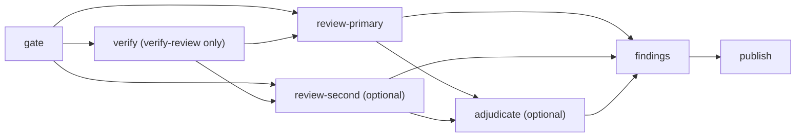

# PR review

agent-ci reviews a pull request when someone with write access asks, checks
every finding against the pull request's real source, and publishes one
inline review plus one summary comment that later runs update in place. The
same pipeline runs in Actions (`pr-review.yml`) and on your machine
(`agent-ci review run`).

To set it up in a repository, copy `consumer-workflows/agent-ci-pr-review.yml`
(see [Workflows](workflows.md#consumer-templates)) and add the secrets from
[Configuration and credentials](configuration.md). The trust boundaries are
in [Security model](security-model.md#pr-review).

## Request a review

Only a user with write, maintain or admin access on the repository can
request a review, in one of three ways:

- Add the `agent-ci:review` label (or `agent-ci:verify-review`). agent-ci
  removes the label once the request is authorized, so adding it again
  starts a new request. A label carries no options.
- Comment on the pull request:

  ```txt
  /agent-ci-review [key=value ...] [--] [instruction]
  ```

  Options come only from the first line, as leading `key=value` tokens:
  `reviewer_model`, `second_reviewer`, `second_reviewer_model`,
  `adjudicator` and `adjudicator_model`. Booleans accept `true`, `1`, `on`,
  `false`, `0`, `off`. `--` ends the options; the rest of the line and every
  following line are the instruction to the reviewers. There is no quoting.
  Naming `second_reviewer_model` or `adjudicator_model` turns that pass on;
  combining it with `second_reviewer=false` or `adjudicator=false` is an
  error. `/agent-ci-verify-review` takes the same options and asks for
  [verify-review](#verify-review).

- Dispatch the caller workflow with `pr_number` and an optional `command`
  (the same text as a comment; blank means `/agent-ci-review`).

Every model a request selects must be in the caller's `allowed_models` and
resolve under the routing policy. A comment or dispatch command with
invalid options, a disallowed model, or a misconfigured caller workflow
gets one reply comment explaining the problem, and the run fails. A label
request that fails gets no reply but also fails the run. A dispatch without
a valid `pr_number` or review command is skipped without a reply and does
not fail. The job summary carries the reason in every case.
Bot-authored commands and edited comments are ignored.

The gate then requires a same-repository, open, non-draft pull request whose
author has write access, or is a bot listed in `allowed_pr_authors`. Fork
pull requests are skipped and never reach a model credential. A request the
gate does not authorize (requester or author without write access, a fork,
a draft or closed pull request, an unlisted bot) gets no reply and does not
fail the run; the job summary says why. Accepted comment requests get an
`eyes` reaction.

### Triggers

Consumers trigger on `pull_request_target` (labeled), `issue_comment`
(created) and `workflow_dispatch`.

- **Label and comment requests** (`pull_request_target`, `issue_comment`)
  always run the caller file from the default branch, so a pull request
  cannot change the caller file, the allowed models, the review policy or
  the agent-ci pin it is reviewed under. Changes to the caller take effect
  once merged.
- **Manual dispatch** (`workflow_dispatch`) runs the caller file at the ref
  the dispatcher selects (the branch picker in the Actions tab, or
  `gh workflow run --ref`). The workflow must exist on the default branch to
  be dispatched, but the run uses the selected ref's caller file, which can
  carry different models, policy or agent-ci pin. The gate does not check
  that ref; it applies the same requester, pull request and author checks
  to every request. Dispatch only from the default branch or another ref
  you trust.

The gate also accepts `pull_request` (labeled). It is meant only for
pre-merge self-tests: on `pull_request` the caller file comes from the pull
request's branch, so consumers should not use it.

## What a review does



1. **Gate** (`agent-ci review gate`, then `prepare`): authorizes the request,
   checks the models, captures the head commit every later job uses, and
   writes a digest-bound request, review spec and diff. After binding the
   spec, it resolves each enabled role's route; only route IDs, credential
   names and account names become job outputs.
2. **Reviewer passes** (`review pass`): the primary reviewer, and the second
   reviewer when `second_reviewer` is on, read the pull request head
   read-only. The separate `review-primary` and `review-second` calls use
   `review-pass.yml`, whose runner receives only its selected model
   credential and, for a pool route, the private proxy origin. It
   re-resolves the exact route under its own runner policy. Claude and Codex
   return schema-constrained output
   (`--json-schema`, `--output-schema`); OpenCode and Cursor return one JSON
   object in their final text. A pass whose answer fails validation gets one
   repair turn by resuming the session (Claude, Codex and OpenCode; not
   Cursor). Reviewer runs never execute a setup command or install
   repository skills, but a Codex or Cursor reviewer's own shell can still
   run commands in the checkout (see
   [Security model](security-model.md#residual-risk)).
3. **Adjudicator** (`review sources`, then `review adjudicate`), when
   `adjudicator` is on: a tool-free Claude/fake harness or the narrow
   Sol Low pool Responses transport reads the
   candidate findings and their cited source, fetched without a checkout,
   in an empty scratch directory. Its `review-adjudicate.yml` runner
   receives only the selected credential and pool-only origin. It may only
   drop or downgrade a finding. It cannot add findings or
   change protected ones (`high`, `critical`, or at or above
   `fail_on_severity`), and the findings gate enforces these limits again;
   if adjudication fails, nothing from it is applied. Sol Low uses native
   fetch with no tools; it does not execute Codex CLI. See
   [adjudicator routing](harnesses-and-routing.md#harnesses).
4. **Findings gate** (`review findings`): a deterministic check over every
   pass and the adjudication. It drops findings whose quoted source does not
   match the file at the captured commits, whose line range or diff position
   is invalid, or whose evidence cannot be recomputed; merges findings
   across passes by fingerprint at the highest surviving severity; skips
   findings already posted by earlier runs; applies the inline floor and the
   shared comment budget. It validates what the reviewers observed, not
   whether a finding is true.
5. **Publish** (`review publish`): rechecks the pull request head, posts
   one inline review and creates or updates the summary comment. If the
   head moved, it posts no findings and only updates the summary to say
   so. It exits non-zero after publishing when the review is incomplete,
   the head moved, or `fail_on_severity` triggered.

Findings have a severity (`critical`, `high`, `medium`, `low`) and a
category (`correctness`, `security`, `performance`, `repo-rule`, `test`,
`maintainability`).

## Inputs

The primary reviewer defaults to Sol 6.1 High. Opus 5.5 High is an optional
second reviewer, and the adjudicator model defaults to Sol 6.1 Low. Both
optional passes remain off unless the caller or request enables them. The
model keys include effort (`gpt-6.1-sol-high`, `gpt-6.1-sol-low`,
`claude-opus-5-5-high`) so each pass selects the intended setting.

These routes use the subscription proxy pool. Before using them in Actions,
configure an admitted self-hosted runner, `allow_pool: true` and the model
secrets. `runs_on` still defaults to `ubuntu-latest` and pool opt-in to
`false`; leaving them unchanged refuses the pool route. The new routes
remain unqualified until their live checks pass.

Sol Low adjudication uses the existing subscription pool directly through
Responses, with `tools: []`, `tool_choice: none`, low effort and a strict
adjudication schema. It retains the run supervisor, guarded artifacts and
one structured repair opportunity using bounded local prompt/answer context;
it never resumes a Codex CLI session. Local protocol tests cover the request
and lifecycle; live proxy compatibility remains unqualified. A caller may
explicitly enable it with `adjudicator: true`; keep
`second_reviewer: false` so Opus runs only on request. The generic consumer
template leaves both optional passes off.

Selected `pr-review.yml` inputs; the workflow file has every input:

| Input                                                  | Default                                                       | Meaning                                                                                                                     |
| ------------------------------------------------------ | ------------------------------------------------------------- | --------------------------------------------------------------------------------------------------------------------------- |
| `reviewer_model`                                       | `gpt-6.1-sol-high`                                            | Primary reviewer.                                                                                                           |
| `second_reviewer`, `second_reviewer_model`             | `false`, `claude-opus-5-5-high`                               | Run an independent second pass on every request.                                                                            |
| `adjudicator`, `adjudicator_model`                     | `false`, `gpt-6.1-sol-low`                                    | Run the adjudicator on every request (Claude or exact Sol Low pool route).                                                  |
| `allowed_models`                                       | `gpt-6.1-sol-high`, `claude-opus-5-5-high`, `gpt-6.1-sol-low` | Models a request may select (newline- or comma-separated).                                                                  |
| `allowed_pr_authors`                                   | empty                                                         | Bot logins whose pull requests may be reviewed.                                                                             |
| `repo_guidance`, `repo_guidance_path`, `context_paths` | empty                                                         | Review guidance appended to agent-ci's baseline, a guidance file read from the PR head, and paths the reviewer reads first. |
| `fail_on_severity`                                     | empty                                                         | `critical`, `high`, `medium` or `low` fails the run after publishing; empty keeps reviews advisory.                         |
| `min_inline_severity`                                  | `medium`                                                      | Lowest severity posted inline; lower findings appear in the summary only.                                                   |
| `max_inline_comments`                                  | `10`                                                          | Inline comment budget per run, shared by every pass (0-100).                                                                |
| `verify`, `verify_config_ref`, `verify_on_self_hosted` | `false`, empty, `false`                                       | [verify-review](#verify-review) settings.                                                                                   |
| `allow_pool`, `runs_on`                                | `false`, `ubuntu-latest`                                      | Proxy-pool opt-in and runner label.                                                                                         |

## Review locally

`agent-ci review run` runs the same stages on your machine for a repository
you can push to:

````bash
export GITHUB_TOKEN   # a token for a user with write access; set it first
agent-ci review run --pr 42 --cwd /path/to/clone --model gpt-6.1-sol-high --allow-pool --publish```

- `--cwd` is a local clone whose `origin` is the repository (default
  `$GITHUB_REPOSITORY` for `--repo`). Each reviewer pass runs in a detached
  worktree at the captured head.
- Without `--publish` it gates, reviews and writes the gated result but
  posts nothing. With it, the review and summary are posted as the token's
  user.
- `--second-model` and `--adjudicator-model` turn those passes on;
  `--instruction` adds a request instruction; `--allow-pool` and
  `--seed-login` admit pool and login routes; `--out` keeps the stage
  artifacts.

The individual stages (`gate`, `prepare`, `verify`, `pass`, `sources`,
`adjudicate`, `findings`, `publish`) are the steps `pr-review.yml` runs.
`agent-ci review <stage> --help` prints a stage's flags, and
`agent-ci review run --help` prints every flag of the local run.

## Verify-review

Verify-review gives the reviewers recorded results of repository checks, so
a finding can cite "the tests fail" as evidence the gate can recompute. It
is off unless the caller sets `verify: true`.

1. **Configure checks** in `.github/agent-ci/checks.yaml` on the default
   branch:

   ```yaml
   version: 1
   setup:
     command: pnpm install --frozen-lockfile
     timeout_minutes: 10
   checks:
     - name: typecheck
       description: TypeScript type check
       command: node_modules/.bin/tsc --noEmit
       timeout_minutes: 10
     - name: unit-tests
       command: node_modules/.bin/vitest run
````

Limits: 1-10 checks with unique names matching `[a-z][a-z0-9-]{0,39}`, a
command of at most 2 KiB, a timeout of 1-30 minutes (default 10), a
one-line description of at most 200 characters, and a 64 KiB file. The
file is read from the head of the default branch, or of the branch the
caller names in `verify_config_ref`, never from the pull request, so a
pull request cannot add or change a check. Do not set
`verify_config_ref` to the pull request's base branch
(`github.base_ref`): its author can retarget the pull request to a
branch they pushed.

2. **Request it** with `/agent-ci-verify-review` or the
   `agent-ci:verify-review` label.
3. **The verify job runs the checks** on the pull request head before any
   reviewer starts. It holds no model credential. agent-ci arrives as a
   digest-pinned bundle from the gate job; the job's read-only
   `GITHUB_TOKEN` and Actions runtime token remain. It runs on a
   GitHub-hosted runner unless
   `verify_on_self_hosted: true`, which is meant only for ephemeral runners
   (agent-ci cannot check that a runner is ephemeral), and it is refused
   in CI with `allow_pool: true`. The optional `setup` command runs first,
   in the pull request head, with the network open: it executes the pull
   request's install scripts and lockfile. Each check runs in a fresh copy of the
   prepared tree, with an environment allowlist that strips tokens, a `PATH`
   without checkout entries, its timeout and a process-group kill, a 1 MiB
   output capture with a masked 16 KiB tail, and, on Linux, isolated user,
   pid, mount and loopback-only network namespaces where the host allows
   them. Results go
   to `checks.json`; each has an evidence ID hashed from the check name,
   command, head commit, exit code and output digest.
4. **Reviewers read the results** through the `run_check` tool, an MCP
   server agent-ci serves from `checks.json`. The model can name a check;
   it cannot pass arguments or run a command. Only Claude and Codex reviewer
   routes can use it; the gate refuses an OpenCode or Cursor reviewer for a
   verify-review request (and `review pass` refuses one with
   `E_POLICY_HARNESS`). In the shipped routing table the only Codex route
   is a pool route, and verify-review is refused in CI with `allow_pool`,
   so verify-review in Actions currently uses Claude reviewers.
5. **The findings gate** recomputes every cited evidence ID and drops
   unknown, forged or tampered citations. The summary shows each check's
   name and exit code, and the isolation the verify job reported.

Checks call installed tools directly (`node_modules/.bin/...`): each check
runs in a copy at another path, and a package manager that verifies its
install by path (for example pnpm's pre-run dependency check) would try to
reinstall without network.

### Verify-review locally

`agent-ci review run --verify` runs the checks on your machine before any
reviewer home or harness exists. The checks run the pull request's code as
you, and no local isolation is a credential boundary, so every local run
also needs `--verify-trust-pr-code`:

```bash
agent-ci review run --pr 42 --cwd /path/to/clone --model claude-haiku-5-5 \
  --verify --verify-trust-pr-code --publish
```

Use it only on pull requests whose code you would run yourself. agent-ci
still applies the isolation the host offers (Linux namespaces with a
read-only host, the macOS sandbox) and pins the harness binary, as hygiene.
Details are in [Security model](security-model.md#verify-review).
